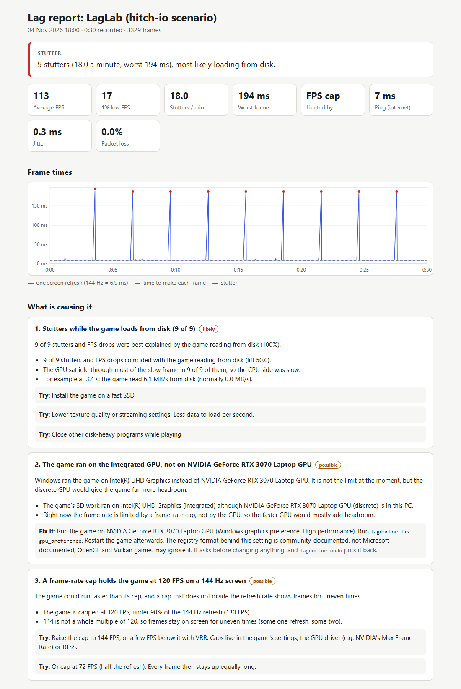
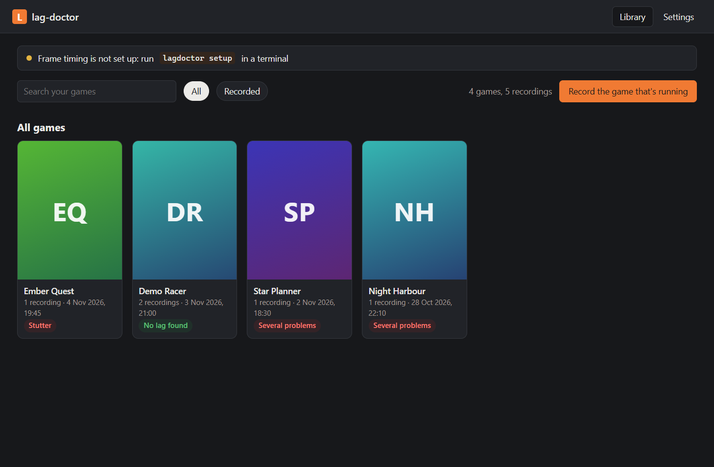
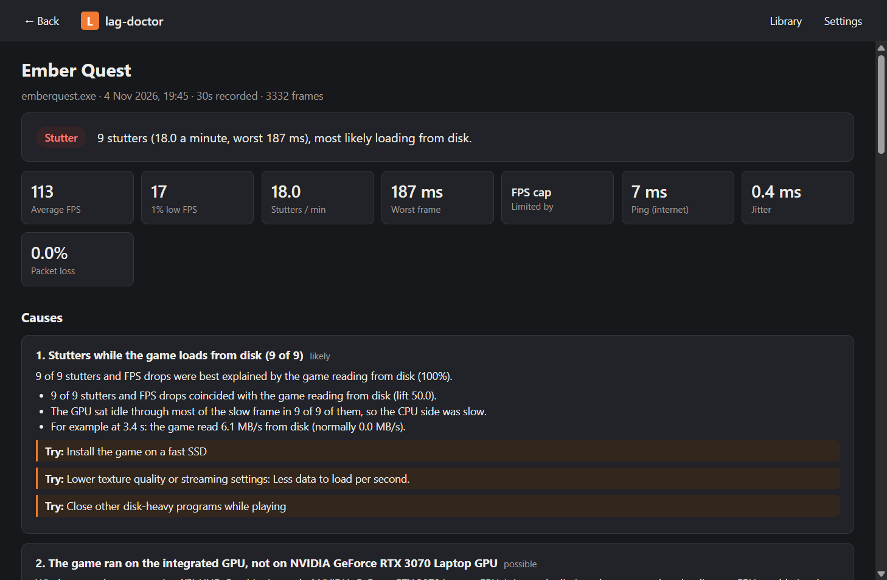

# lag-doctor

[](https://github.com/Ali0600/lag-doctor/actions/workflows/ci.yml)

Finds out **why a PC game lags** (low FPS, stutter, uneven pacing or network lag) by watching it from
outside while you play, explains the cause with the numbers behind it, and fixes what can be fixed safely.
Its own code never injects into, hooks or opens the game process. The one exception is PresentMon, which it
runs for frame timing: PresentMon holds a query-only handle to the game, the kind Task Manager uses. No tool
can promise what a given anti-cheat accepts.

Status: a working command-line tool for Windows 10/11 with a desktop window for its results, built on one hybrid-GPU laptop; CI runs its tests on
GitHub's Windows runners for every change, and builds, installs and uninstalls its MSI there. The parts that need
admin rights (live frame timing and the game-server tracker) are tested against recorded traces and private trace
sessions; their live check is `scripts/e2e.py` (see Testing).



*The HTML report for a synthetic capture from the test suite (LagLab's disk-hitch scenario): the numbers are
generated, the analysis and the page are the real ones.*

## What it does

- **Records while you play**: every frame's timing (Intel PresentMon), the game's CPU per thread, GPU load
  and video memory, disk, RAM, CPU/GPU throttling, and the network path (router, internet, the game server's
  packet stream). Press **Ctrl+Alt+L** the moment it lags; the analysis looks at what happened just before.
- **Explains**: the lag type, the likely causes ranked with their evidence ("9 of 9 stutters and FPS drops
  coincided with the game reading from disk"), what was **checked and fine**, and what **could not be
  checked** and why. Nothing unmeasured is ever reported as fine.
- **Fixes, only with your OK**: the power plan, the GPU a game runs on (hybrid laptops), the screen refresh
  rate, Game Mode, background recording, windowed-game optimisations, and the priority of your own
  background programs. Each change is journaled first, verified by reading it back, and undone with
  `lagdoctor undo`. It never turns off a security feature, never kills or suspends a process, and never
  touches the game.

## Install

A per-machine installer, `lag-doctor-0.1.0-x64.msi`, is built and tested by CI on every change and kept as the
`lag-doctor-msi` artifact of each [CI run](https://github.com/Ali0600/lag-doctor/actions/workflows/ci.yml) (GitHub
asks you to sign in to download one). There is no release yet and the MSI is not signed (`docs/INSTALLER-PLAN.md`,
Stage 5), so SmartScreen may warn before it runs, and a PC with Smart App Control on is expected to refuse it.

```powershell
msiexec /i lag-doctor-0.1.0-x64.msi          # or double-click it: one UAC prompt, no questions
lagdoctor check                              # in a new terminal window: PATH changes reach new windows only
```

- It installs to `C:\Program Files\lag-doctor`: python.org's embeddable Python 3.13.17 (signed by the Python
  Software Foundation), lag-doctor's code, and Intel's PresentMon 2.6.0, byte for byte the release `lagdoctor setup`
  pins, with Intel's licence. Only its `bin\` folder, which holds `lagdoctor.cmd`, goes on the system PATH, so the
  bundled Python never stands in for your own `python`. `lagdoctor setup` finds that PresentMon: nothing to download.
- It adds **lag-doctor** to the Start menu: the app's window (`lagdoctor app`, below), with its own icon on the
  taskbar.
- Each recording still asks for one UAC prompt (`watch --elevate`) until the capture service lands (Stage 4); the
  part that runs elevated then runs only code from Program Files, which only an administrator can change.
- Uninstall it from Settings > Apps > Installed apps, or with `msiexec /x lag-doctor-0.1.0-x64.msi`; CI checks that
  no file, PATH entry, Start-menu shortcut or Windows Installer key is left. Your recordings and the app's own folders
  stay in `%LOCALAPPDATA%\lag-doctor` (its `webview` folder is the window's browser data); delete that folder to
  remove them too.
- After Ctrl+C ends a recording in the same window, cmd may ask "Terminate batch job (Y/N)?": the recording is
  already saved, so either answer is fine.

## Run it

In PowerShell (Python 3.13, the version the installer ships, managed by [uv](https://docs.astral.sh/uv/), which
downloads it if the PC lacks it):

```powershell
git clone https://github.com/Ali0600/lag-doctor         # get the code
cd lag-doctor
uv sync                                                 # create .venv, with the lagdoctor command in it
uv run lagdoctor setup                                  # download + verify PresentMon 2.6.0 (asks first)
uv run lagdoctor check                                  # settings check-up, no game needed
uv run lagdoctor watch --game eldenring.exe             # or --pid PID; with neither, the busiest game
uv run lagdoctor fix --list                             # the automatic fixes the last report suggested
uv run lagdoctor fix power_plan                         # shows before -> after and asks
uv run lagdoctor undo                                   # what lag-doctor changed; undo an ID, or --all
uv run lagdoctor analyze CAPTURE                        # re-run the analysis on a saved capture
uv run lagdoctor app                                    # your recorded games and their results, in a window
```

- **`lagdoctor app` opens lag-doctor's own window** (or **lag-doctor** in the Start menu, once installed): every game
  you have recorded, each game's recordings, and Results to explore (the verdict and causes, zoomable frame-time,
  CPU/GPU, NVIDIA and ping charts, the lag moments with what the PC did around each, checked and fine, not
  measured), plus Compare for two recordings of a game, with the conditions each ran under and what changed in the
  game itself between them. Recording from the window comes next; for now record with `lagdoctor watch`.

- **Judging a fan fix**: record, install the fix, record again, and compare the two. When a recording starts,
  lag-doctor reads the game's folder (never the game itself) for the files a fan fix adds: the DLLs Windows would
  otherwise load from System32 (`dxgi.dll`, `dinput8.dll` ...), ASI plugins and their settings, an Unreal game's
  `~mods` paks; and for an Unreal game, its user settings files (`Engine.ini`, `GameUserSettings.ini`). Compare lists
  them side by side, marks a file that changed between the two, and shows the exe's size and date, so a game update
  shows too. A setting kept anywhere else is not seen. It needs Microsoft's WebView2 Runtime, which Windows 11 has. It
  is a window, not a web page: nothing is served and it opens no network connection.





*The window on the test suite's demo library: made-up games, synthetic recordings, the real screens.*

- **`lagdoctor` is a command in `.venv`**: after `.venv\Scripts\activate`, plain `lagdoctor watch ...` works in that
  window. `uv build` makes a wheel of the `lagdoctor` package alone (`dist\`); nothing is published yet.

- **A recording ends** with Ctrl+C, after `--duration S`, or when the game exits. After the first Ctrl+C it
  says it is stopping and saving, and a second press cannot lose the capture.
- **Frame timing uses Windows event tracing (ETW), which needs admin rights.** `watch` offers one UAC prompt
  per recording (`--elevate` skips the question, `--no-elevate` records without frame timing). Only PresentMon and
  the network trace then run elevated, in lag-doctor's relay: a background process with no window, which passes
  their data back over a locked pipe. The recording itself stays in your window, where Ctrl+C stops it. `setup`
  explains the alternative of joining *Performance Log Users* once, which covers frame timing
  but not the game-server tracker (Windows does not let that group start it; `--elevate` still does).
  Without either, everything else is still measured and the report says frame timing was not.
- **No silent recordings without frame timing.** If PresentMon is missing or fails its check, `watch` stops
  before it records and says what to run (`--no-elevate` records everything else anyway). If frame timing stops
  working mid-recording, or the game is in front for 10 s without a frame, it says so on the spot.
- **Run it from your own PowerShell window.** A shell that a packaged app started (the Claude desktop app is one)
  can have what it saves under AppData moved into that app's private folder, which your other windows never
  see. lag-doctor checks where its files really land, and refuses to set up, record
  or fix from such a shell.
- **Closing the recording window** also stops and saves, but Windows allows a closing console about 5
  seconds. A 30-minute recording at 144 FPS saves in 2.6 s; much longer ones may not make it. Signing out or
  shutting down mid-recording loses the recording.
- Each recording is saved under `%LOCALAPPDATA%\lag-doctor\sessions\` with a self-contained HTML report
  (charts, causes, checked-and-fine, not measured) and the raw capture. The report never shows your Windows
  user name (see Privacy), so it can be shared.

## Limits

- **GPU heat, clocks and throttling are NVIDIA-only** (NVML). On other GPUs the load and video memory still
  come from Windows counters.
- **From a checkout, `--elevate`, `scripts/e2e.py` and `scripts/etw_access.py` run its Python code as
  administrator.** A program already running as you could edit that code and ride along on the prompt you approve.
  Approve them only for a checkout you trust, or install the MSI, whose `--elevate` runs only code under Program
  Files. For recordings, joining Performance Log Users skips elevation (frame timing then works without it; the
  game-server tracker does not).
- **Frame caps a hair under the refresh rate** (about 143.3–144 FPS on a 144 Hz screen) can still count a
  frame held one refresh longer than usual as a stutter.
- **The low-frame-rate threshold** (80 % of the refresh rate) comes from a study of 60–120 Hz screens and is
  not tuned above that.
- **Long recordings use RAM**: about 0.7 KB per frame, so a 3-hour evening at 240 FPS needs about 1.8 GiB.
- **Single-player games: add `--no-network`.** The game-traffic tracker follows UDP only, so it cannot tell an
  offline game from one that talks to its server over TCP. Without the flag, internet ping spikes and lost
  pings count as network lag even in a game that never goes online.

## How it works

```
 game (untouched) ──► ETW ──► PresentMon ──► frames ─┐
 Windows counters (PDH), NtQuerySystemInformation ──► system (4 Hz) ─┤
 NVML ──► NVIDIA clocks, temperature, throttling ──► gpu (1 Hz) ─────┼─► capture ─► analysis ─► report
 ICMP, Wi-Fi, NIC counters ──► network (2 Hz) ───────────────────────┤        (one QPC clock)   + fixes
 ETW Kernel-Network ──► the game server's packet stream ─────────────┘
```

- One clock (QueryPerformanceCounter) for every source, so a stutter lines up exactly with the CPU, GPU,
  disk and network samples around it.
- **Analysis**: finds stutters, FPS drops, pacing problems, ping spikes, packet loss and server silences;
  decides whether the GPU, one CPU thread, VSync or a frame cap limits the frame rate (Intel's GPU Busy
  method); links each stutter to what changed at that moment (a lift test against the calm stretches); then
  36 rules score causes by evidence family, so no single signal is counted twice.
- **Layout**: `lagdoctor/winapi` (thin ctypes wrappers), `capture` (one collector per source plus the
  session), `relay` (PresentMon and the network trace with admin rights, for a recording in your own window),
  `analysis`, `fixes` (journal, readback, undo), `report` (console and HTML). `laglab/` is a fake game that lags
  on purpose, used to test the whole chain. `docs/DESIGN.md` is the contract between them.

## Testing

```powershell
uv sync --group laglab                                         # adds pyglet, for LagLab
uv run pytest -q                                               # unit + live read-only tests
uv run python scripts/redfirst.py tests/redfirst/<area>.json   # prove each guard's test can fail
uv run python scripts/e2e.py                                   # LagLab scenarios, judged end to end (UAC prompt)
uv run python scripts/etw_access.py                            # who may trace on this PC (read-only, UAC prompt)
uv build --clear --out-dir dist                                # the sdist and the wheel, as CI builds them
uv run python scripts/wheel_check.py dist                      # install the wheel in a fresh venv and run it there
```

- **LagLab** produces one known cause per scenario (GPU-bound, CPU-bound, CPU hitch, disk hitch, wait hitch,
  background hogs, uneven pacing, and a smooth control) and logs the ground truth on the same clock.
  `scripts/e2e_truth.py` scores each diagnosis against that log: found the lag moments, invented none,
  blamed the right cause.
- **Red first**: every guard ships with a mutation that must turn its test red. `scripts/redfirst.py`
  applies each one to a throwaway copy of the repo, runs the named tests there, and counts it only when a
  test failed (an import error does not count); the real working tree is never written.
- **No real settings change in tests**: registry fixes run in a sandbox key that is deleted afterwards, the
  power, display and GPU-preference backends are faked, and priority tests act only on a child process the
  test started.
- PresentMon's parser is tested against its own gold ETW captures replayed through the real exe, and the
  ETW consumer against private in-process sessions, so neither needs admin rights in the test suite.
- **CI** (`.github/workflows/ci.yml`) runs the suite on GitHub's Windows Server 2025 runners for Python 3.13, the
  version the MSI ships, on every pull request and on every push to `main` except one that changes only `docs/`,
  `CLAUDE.md` or `.github/SECURITY.md`: no job reads those, and a test scans everything the jobs run to keep that
  true. A runner has no GPU, no NVIDIA driver, no thermal sensors and no ping replies: the workflow declares that in
  `LAGDOCTOR_ABSENT`, and the tests marked as needing those skip there with the reason. Its High performance plan
  needs no declaring: the power tests hold on any plan. On a PC without an NVIDIA GPU, set
  `$env:LAGDOCTOR_ABSENT = "nvidia"` before running the tests, or the NVIDIA ones fail.
- **The wheel, installed**: a second CI job builds the wheel, installs it into a fresh venv and runs `lagdoctor`
  there, outside the checkout (`scripts/wheel_check.py`). The wheel must hold exactly the files git tracks under
  `lagdoctor/`, every module must import from that venv, `--version` must name the wheel's version, and `analyze`
  must write its report for a synthetic capture. `--help` and `analyze` alone would miss most of that: `analyze`
  never imports most of `capture/`, `fixes/` and `winapi/`.
- **The MSI, installed**: a third CI job builds the MSI with WiX v7 from the wheel, the pinned Python runtime and the
  pinned PresentMon (`scripts/msi_build.py`), installs it on the throwaway runner, runs `lagdoctor` from a fresh shell
  (cmd and Windows PowerShell, with the environment a new sign-in gets), uninstalls it, and reads back that no file,
  PATH entry or Windows Installer key is left (`scripts/msi_check.py`, which refuses to run anywhere but a
  GitHub-hosted runner). Three MSIs broken on purpose each failed it where they should: one missing a module, one
  whose uninstall left its PATH entry, and one without its bytecode, where an administrator's run wrote into
  Program Files and the uninstall left that behind.
- **Only what the shipped runtime imports**: python.org's embeddable runtime leaves tkinter, IDLE, turtle, venv and
  ensurepip out of the standard library, so `tests/test_stdlib_only.py` lets `lagdoctor/` import only the modules
  that runtime says it can (`scripts/runtime_modules.json`, which `scripts/runtime_modules.py` asks of the pinned
  ZIP's own `python.exe`). The MSI job asks it again first and fails unless the JSON is its answer.
- **Downloaded test data**: the tests that replay or verify the real PresentMon need its pinned release and its gold
  captures. `uv run lagdoctor setup` gets the first, `uv run python -m tests.downloads fetch-gold` the
  second; without them those tests skip with the reason. CI gets both the same way before the tests, checks them
  against the tests' own pins, caches them, and sets `LAGDOCTOR_REQUIRE` so a missing one fails those tests
  instead; each job's summary counts them.

## Code signing policy

Nothing is signed yet. Once a first unsigned preview is released, lag-doctor applies to SignPath Foundation for free
code signing (`docs/INSTALLER-PLAN.md`, Stage 5), and from then on: Free code signing provided by
[SignPath.io](https://about.signpath.io), certificate by [SignPath Foundation](https://signpath.org).

- **What is signed**: the MSI, built by this repository's CI from its own source (the msi job in
  `.github/workflows/ci.yml`). The upstream files inside it are signed by their makers and verified, not re-signed:
  python.org's runtime by the Python Software Foundation, PresentMon by Intel. `lagdoctor.cmd` is a batch file, which
  cannot carry a signature.
- **Product name and version**: every signed file names the product `lag-doctor` and the version in
  `pyproject.toml`; CI's build reads back the MSI's product name, version and publisher and its summary's subject and
  author.
- **Team roles**: committers and reviewers: the maintainer, [Ali0600](https://github.com/Ali0600); approver of each
  signing request: the same.

## Privacy

lag-doctor sends no data about you or your PC anywhere: no telemetry, crash reports, update checks or account.
Recordings, reports and the fix journal stay on your PC, under `%LOCALAPPDATA%\lag-doctor`. This program will not
transfer any information to other networked systems unless specifically requested by the user or the person
installing or operating it.

The HTML report shows a folder under your user profile as `%LOCALAPPDATA%\...`, `%APPDATA%\...` or
`%USERPROFILE%\...`, never with your Windows user name, so you can share it when asking for help. The raw capture
and the summary in the terminal keep the real paths.

While it records, lag-doctor measures your connection, which `--no-network` turns off:
- it pings your router, `1.1.1.1` (Cloudflare's public DNS, the internet anchor) and the game's server, each twice
  a second; a ping carries no data, though each receiver sees your IP address, as with any traffic;
- the game-server tracker checks itself once per recording by looking up `example.com` through `1.1.1.1`, over UDP
  and TCP ([Cloudflare's privacy policy for it](https://developers.cloudflare.com/1.1.1.1/privacy/public-dns-resolver/)).

The network trace sees every program's traffic, so the relay that runs it with admin rights passes back only the
game's own packets, its own self-check's, and, for other programs, how many bytes each received and sent, only for
programs in your Windows session: never another user's programs or Windows' own services.

`lagdoctor setup` downloads PresentMon from GitHub only when you agree, and the installer already carries it.

lag-doctor's window (`lagdoctor app`) is drawn by Microsoft's WebView2 Runtime, part of Windows. Its pages are
lag-doctor's own files, which may not reach the network, and the app turns off what it can: WebView2's crash reports
go nowhere (crash dumps stay on your PC) and its SmartScreen check of the pages it shows is off (Windows' own
SmartScreen is untouched). WebView2 itself still sends Windows' required diagnostic data to Microsoft, and optional
data as your Windows settings allow, whatever an app does; once in a while a WebView2 process was seen holding a
connection to Microsoft, as the runtime does on its own.

## Experience Gained

- **Windows systems programming from Python**: 17 ctypes modules over 17 Windows DLLs plus NVIDIA's NVML
  (real-time and private ETW sessions, PDH, NtQuerySystemInformation, DXGI/DXCore, ICMP, WLAN) and no third-party
  package at run time, with zero handles opened to the game and imports limited to the 264 standard-library modules
  the shipped Python runtime itself reports it can import, both enforced by syntax-tree scans of the code; and a
  desktop app in its own WebView2 window over raw COM vtables, with no loader DLL and its 98 slots and 34 IIDs pinned
  against Microsoft's SDK IDL, whose tests drive the real window on CI and crash its page and its browser process to
  prove both recover.
- **Telemetry on one clock**: 5 collectors (per-frame timing, a 4 Hz system sampler, 1 Hz NVIDIA telemetry,
  2 Hz network probes, an ETW packet tracker) stamped by QueryPerformanceCounter, so a stutter lines up with
  the samples around it.
- **A diagnosis engine judged against ground truth**: 36 rules with lift-test attribution and
  evidence-family scoring, scored end to end against LagLab, a fake game with 8 scenarios that logs what it
  did wrong.
- **Testing that proves itself**: 3,311 tests, run in CI on GitHub's Windows runners on the exact Python the MSI
  ships, with SHA-pinned actions, skipping pushes that change only docs (20 of the first 42 to main) under a test
  that scans every job's inputs, beside jobs that run the built wheel in a fresh venv and the MSI on a throwaway
  runner; the
  hardware a runner lacks is declared, so those tests skip there by name and still fail on the laptop if a bug hides
  the hardware, and the 42 tests on the real PresentMon get its release and gold captures fetched, pinned and cached
  there, failing rather than skipping if they go missing; plus a mutation harness of 2,083 deliberate sabotages in
  44 specs that must each turn a test red, run on a throwaway copy of the tree with hash checks.
- **Safe automation of system changes**: 7 opt-in fixes behind a write-ahead journal, readback
  verification, undo and crash healing, with a handle-free identity check before touching any process.
- **Supply chain and least privilege**: a per-machine WiX MSI of 179 files built in CI from pinned inputs (Python
  runtime and PresentMon by SHA-256, WiX by SHA-512), installed, run from a fresh shell and uninstalled on a
  throwaway runner with nothing left behind, its Start-menu shortcut and app ID read back from the installed
  link, its check proven by 3 sabotaged builds; PresentMon checked through a deny-write handle and launched by
  that handle's resolved path; only PresentMon and the ETW trace run elevated, in a windowless relay behind 1
  UAC prompt that passes back only the game's data and the player's own programs' byte totals; the planned
  capture service measured on GitHub's runners before it ships (a 1-privilege LocalService
  service enabling all 13 ETW providers, a named-pipe trigger starting it in 0.08 s), and its pipe locked 6 ways
  (first instance, local clients only, an exact DACL, no access below medium integrity, identification-level
  clients, checked names), each lock tested against the attack it stops.
- **Review to fix**: closed all 49 findings (12 high) of an adversarial code review in 3 verified fix waves,
  cut the capture save from 36 s to 2.6 s to fit the 5 s Windows gives a closing console, and traced a 14-minute
  game recording with no frame timing to Windows keeping a packaged app's AppData files in a private copy.

## Credits

Frame timing comes from [Intel PresentMon](https://github.com/GameTechDev/PresentMon) 2.6.0 (MIT licence),
downloaded and hash-verified at setup, or bundled in the MSI with Intel's licence text
(`installer/PresentMon-LICENSE.txt`). The tests replay PresentMon's own gold ETW captures. The repo carries
some of PresentMon's own output, Copyright Intel Corporation under the MIT licence: its `--help` text
(`docs/research/presentmon-2.6.0-help.txt`) and trimmed captures in `tests/fixtures/presentmon/`, whose README
holds the licence text. The MSI bundles python.org's embeddable Python 3.13.17 unchanged (Python Software
Foundation licence, its `LICENSE.txt` included) and is built with the [WiX Toolset](https://wixtoolset.org) v7.

## Licence

lag-doctor is released under the [MIT licence](LICENSE).
